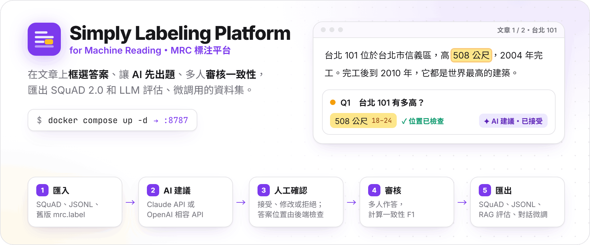
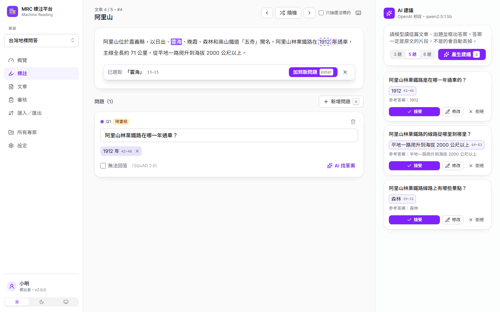
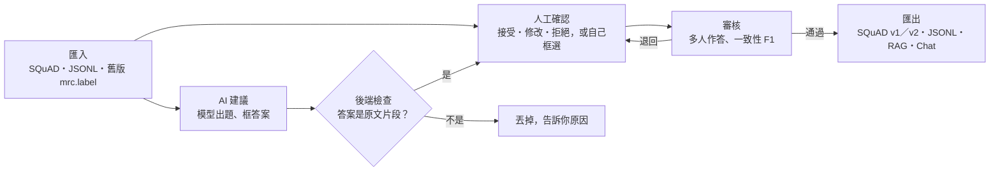
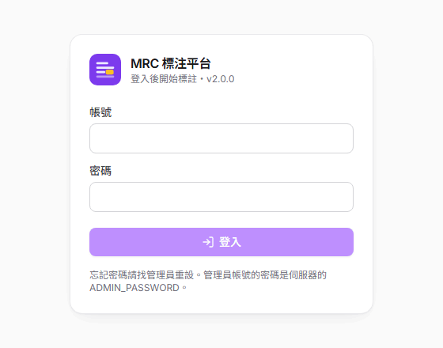
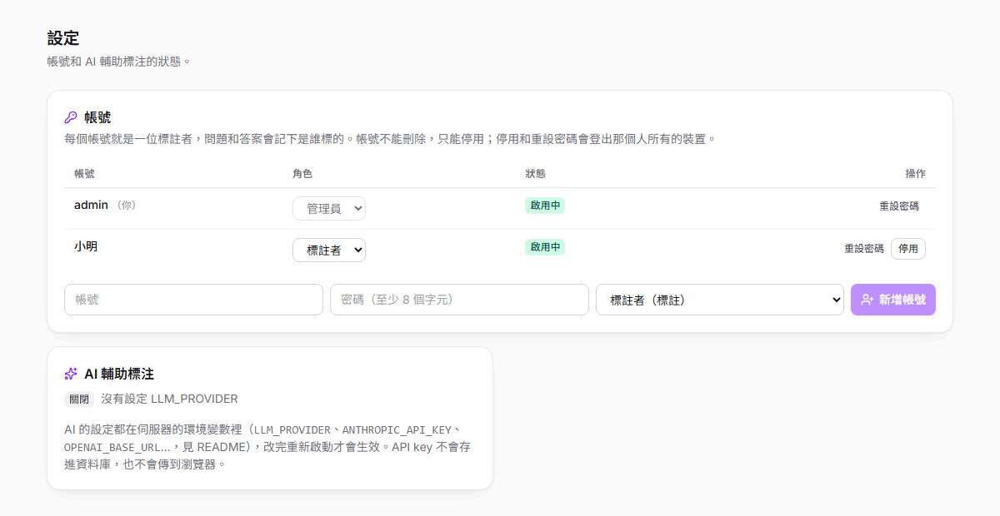
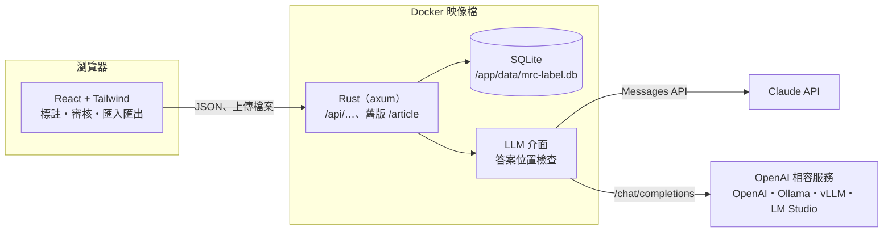
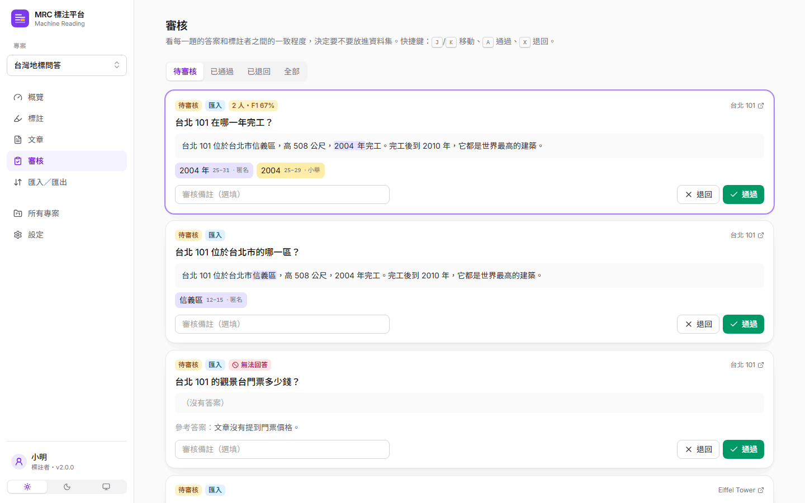
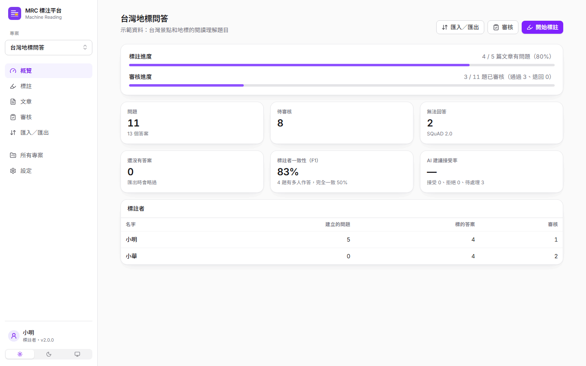

<p align="center">
  <picture>
    <source media="(prefers-color-scheme: dark)" srcset="https://raw.githubusercontent.com/NatLee/simply-labeling-platform-for-machine-reading/main/docs/images/hero-dark.png">
    
  </picture>
</p>

<p align="center">
  <a href="https://github.com/NatLee/simply-labeling-platform-for-machine-reading/actions/workflows/ci.yml"></a>
  
  
  
  
  <a href="LICENSE"></a>
</p>

自架的機器閱讀理解（MRC，讓模型讀文章回答問題）標注平台。在文章上用滑鼠框選答案，平台記下精準的字元位置；一個問題可以有多個答案，也可以標成「無法回答」（SQuAD 2.0）。可以請模型先出題、框好答案，人再接受、修改或拒絕；多位標註者對同一題作答時，平台會算出彼此的一致程度，交給審核者決定要不要放進資料集。資料可以匯出成 SQuAD、Hugging Face 的 JSONL，或給 LLM 用的 RAG 評估和對話微調格式。

後端是 Rust（axum）加 SQLite，前端是 React 和 Tailwind CSS，整套打包成一個 Docker 映像檔。AI 輔助標注可以接 Claude API，也可以接任何 OpenAI 相容的服務（OpenAI、Ollama、vLLM、LM Studio）；沒設定時這個功能自動關閉，其他功能照常。

<picture>
  <source media="(prefers-color-scheme: dark)" srcset="https://raw.githubusercontent.com/NatLee/simply-labeling-platform-for-machine-reading/main/docs/images/screenshot-annotate-dark.png">
  
</picture>

## 功能

- **標註**
  - 在文章上選取文字就是答案，前後的空白會自動去掉。位置用字元計算，和 SQuAD、Python 一樣；文章裡有 emoji 也不會算錯。
  - 一個問題可以有多個答案，也可以勾「無法回答」。另外可以寫一段自由作答的「參考答案」，給評估或微調 LLM 用。
  - 「隨機換一篇」可以只抽還沒標的文章；也可以照順序上一篇、下一篇。
  - 鍵盤快捷鍵：`Enter` 加入答案、`N` 新問題、`U` 無法回答、`Ctrl+Enter` 儲存、`G` AI 出題、`←` `→` 換文章、`R` 隨機、`?` 看全部。
- **AI 輔助標注**
  - 「產生建議」請模型讀文章出題並框出答案；「AI 找答案」替你寫好的問題找答案。
  - 模型給的答案一定要是文章裡一字不差的片段，後端會自己找出位置；不是的建議直接丟掉，畫面會告訴你丟了幾題、為什麼。
  - 每一題都要人按接受、修改或拒絕才會存成資料。資料庫會記下哪些題目和答案來自 AI、有沒有被人改過。
- **多人標註和審核**
  - 標註者只要選名字，不需要登入。別人已經作答的題目，會先藏起他的答案（盲標），你標完再顯示。
  - 同一題有兩位以上作答時，平台用 SQuAD 官方評估的算法算一致程度（完全一致率和 F1，中文一字一個 token）。
  - 審核頁列出每一題的答案、作答者和一致程度，可以通過、退回或寫備註；`J` `K` 移動、`A` 通過、`X` 退回。
- **專案、文章和進度**：一個專案是一份資料集。概覽頁顯示標註和審核進度、無法回答和還沒有答案的題數、一致程度、AI 建議接受率，以及每位標註者的數量。
- **匯入匯出**：見下方「資料格式」。同一個檔案匯入兩次不會重複。
- **登入（選用）**：預設和舊版一樣不用登入；設了 `ADMIN_PASSWORD` 就啟用內建登入，帳號分標註者、審核者和管理員（見「登入」）。
- **和舊版相容**：可以匯入舊版 Flask 平台的資料庫 `mrc.label`；舊版的 3 個 HTTP API 也還在（見「從舊版升級」）。

## 快速開始

需要 Docker 和 Docker Compose。

```bash
git clone https://github.com/NatLee/simply-labeling-platform-for-machine-reading.git
cd simply-labeling-platform-for-machine-reading
docker compose up -d --build
```

打開 <http://localhost:8787>（和舊版一樣的 port；要換的話設 `MRC_PORT`，例如 `MRC_PORT=9000 docker compose up -d`）：

1. 第一次進來，左下角選「選擇標註者」，輸入你的名字。（啟用登入時，改成用帳號登入，見「登入」。）
2. 在「所有專案」新增一個專案。
3. 到「文章」貼上一篇文章，或到「匯入／匯出」上傳 [`docs/examples/sample-squad-v2.json`](docs/examples/sample-squad-v2.json) 這個範例資料集。
4. 到「標註」開始框選答案；寫好的題目到「審核」通過或退回。
5. 到「匯入／匯出」選格式下載。

也可以全部用 API 做（完整規格見 [docs/api.md](docs/api.md)；下面是沒啟用登入的情況，啟用時每個 `curl` 加上 `-b cookies.txt`）：

```bash
# 建立專案，回傳的 id 用在下面
curl -s -H 'content-type: application/json' -d '{"name":"demo"}' http://localhost:8787/api/projects
# {"id":1,"name":"demo","description":"","created_at":"2026-11-04T00:20:22Z"}

# 匯入範例資料集
curl -s --data-binary @docs/examples/sample-squad-v2.json \
  -H 'content-type: application/octet-stream' http://localhost:8787/api/projects/1/import
# {"format":"SQuAD JSON","articles_created":2,"articles_merged":0,"questions_created":6,"questions_skipped":0,
#  "answers_exact":5,"answers_moved":0,"answers_dropped":0,"warnings":[]}

# 匯出成 Hugging Face 的 JSONL（一行一題）
curl -s -o demo.jsonl "http://localhost:8787/api/projects/1/export?format=jsonl"
head -1 demo.jsonl
# {"id":"zh-1","title":"台北 101","context":"台北 101 位於台北市信義區，高 508 公尺，…","question":"台北 101 有多高？",
#  "answers":{"text":["508 公尺"],"answer_start":[18]}}
```

匯出的 JSONL 可以直接用 Hugging Face 的 `datasets` 載入：

```python
from datasets import load_dataset

ds = load_dataset("json", data_files="demo.jsonl", split="train")
print(ds[0]["question"], ds[0]["answers"])
# 台北 101 有多高？ {'answer_start': [18], 'text': ['508 公尺']}
```

## 標注流程



## AI 輔助標注

用環境變數設定。把值寫在 repo 資料夾的 `.env`（和 `docker-compose.yml` 同一層，已經被 `.gitignore` 和 `.dockerignore` 排除），再執行 `docker compose up -d`。沒設定 `LLM_PROVIDER` 時 AI 功能關閉，畫面上會說明原因。

| 變數 | 預設 | 說明 |
|---|---|---|
| `LLM_PROVIDER` | （空） | `anthropic` 或 `openai`；沒設定就關閉 AI 功能 |
| `ANTHROPIC_API_KEY` | （空） | 用 Claude API 時必填 |
| `ANTHROPIC_MODEL` | `claude-opus-5-5` | Claude 的模型 |
| `ANTHROPIC_BASE_URL` | `https://api.anthropic.com` | 走代理或測試時才需要改 |
| `OPENAI_BASE_URL` | `https://api.openai.com/v1` | OpenAI 相容服務的網址，例如 Ollama 是 `http://ollama:11434/v1` |
| `OPENAI_API_KEY` | （空） | 本機的 Ollama、vLLM 通常不需要 |
| `OPENAI_MODEL` | （空） | 用 OpenAI 相容服務時必填 |

API key 只從環境變數讀，不會寫進資料庫，也不會傳到瀏覽器；網頁只看得到用哪一家和哪個模型。

**Claude API**：直接呼叫 Messages API，用 structured outputs 要求模型照 JSON Schema 回答，`effort` 設 `medium`。模型的安全機制拒絕時，會自動改用 Anthropic 建議的備援模型（server-side fallback）；還是拒絕的話，畫面會顯示「模型拒絕回答」。

```dotenv
LLM_PROVIDER=anthropic
ANTHROPIC_API_KEY=sk-ant-...
```

**本機的 Ollama**：`docker-compose.yml` 裡有一個選用的 `ollama` 服務。

```bash
docker compose --profile ollama up -d
docker compose exec ollama ollama pull qwen2.5:1.5b
LLM_PROVIDER=openai OPENAI_BASE_URL=http://ollama:11434/v1 OPENAI_MODEL=qwen2.5:1.5b docker compose up -d
```

小模型出的題目品質不穩（例如問題用錯語言、答案不對題），這也是每一題都要人確認的原因。答案不是原文片段的建議會被後端擋掉，不會出現在畫面上。

驗證狀態：OpenAI 相容 API 用 Ollama 0.40.5 加 `qwen2.5:0.5b`、`qwen2.5:1.5b` 實際跑過；Claude API 的請求格式、重試和錯誤處理只用本機的假伺服器測過，還沒有用真的 API key 呼叫。

## 登入（選用）

預設不需要登入，和舊版一樣。設定 `ADMIN_PASSWORD` 就會啟用內建登入；要放到網路上，或開了 AI 功能（別人可能用掉你的 API 額度）時，建議打開。

| 變數 | 預設 | 說明 |
|---|---|---|
| `ADMIN_PASSWORD` | （空） | 設了才啟用登入，至少 8 個字元。沒有預設密碼 |
| `ADMIN_USERNAME` | `admin` | 管理員帳號 |
| `PUBLIC_URL` | （空） | 外部看到的網址，例如 `https://label.example.com`。是 https 時登入 cookie 會加 Secure |
| `COOKIE_SECURE` | 依 `PUBLIC_URL` | `true` 或 `false`，要自己決定 cookie 加不加 Secure 時才設 |

寫在 `.env` 再執行 `docker compose up -d`：

```dotenv
ADMIN_PASSWORD=換成一個長一點的密碼
PUBLIC_URL=https://label.example.com
```

- 啟動時，管理員帳號不存在就建立；已經存在的話，密碼會改成 `ADMIN_PASSWORD` 的值。忘記管理員密碼時，改這個變數再重新啟動就好（密碼改了會登出那個帳號所有的裝置）。
- 管理員在「設定」新增其他帳號、改角色、停用或重設密碼。帳號不能刪除，因為題目和答案上記著是誰標的。
- 登入後，標註者就是帳號本人，不能再用別人的名字標註。啟用登入前用某個名字標的資料，會歸到同名的帳號。

| 角色 | 可以做什麼 |
|---|---|
| 標註者（`annotator`） | 看資料、新增文章、標註、使用 AI 建議 |
| 審核者（`reviewer`） | 標註者能做的，加上審核和匯出 |
| 管理員（`admin`） | 全部，包括新增、修改、刪除專案，刪除文章，匯入，管理帳號 |

安全上的做法：密碼用 argon2 雜湊；登入狀態放在 HttpOnly、SameSite=Lax 的 cookie（網頁上的 JavaScript 讀不到）；寫入的 API 只接受同一個網站送來的請求，擋掉跨站請求偽造（CSRF）；同一個帳號 15 分鐘內登入失敗 5 次就暫停登入。密碼和 cookie 在網路上是明文傳送，所以**請放在 HTTPS 後面**（例如 Caddy、nginx 或 Cloudflare Tunnel 的反向代理），並把 `PUBLIC_URL` 設成 https 的網址。

啟用登入後，所有 API 都要登入，包括 AI 建議、匯入匯出和舊版的 3 個 API。用腳本呼叫時，先登入拿 cookie：

```bash
curl -s -c cookies.txt -H 'content-type: application/json' \
  -d '{"username":"admin","password":"你的密碼"}' http://localhost:8787/api/auth/login
curl -s -b cookies.txt http://localhost:8787/api/projects
```

<p align="center">
  
  
</p>

## 資料格式

**匯入**（格式自動判斷）：

- SQuAD v1.1／v2.0 JSON。同一個 `title` 底下的每一段 `context` 變成一篇文章，`id`、`is_impossible`、`plausible_answers` 都會保留。
- JSONL：Hugging Face squad／squad_v2 的欄位（`answers` 可以是 `{"text": [...], "answer_start": [...]}` 或 SQuAD 的陣列），或一行一篇 `{"title": …, "context": …}` 只匯入文章。
- 舊版平台的 SQLite 資料庫 `mrc.label`。

每個答案都會重新檢查位置。對不上的話，平台會在文章裡找同樣的文字，改用最近的位置；找不到就不匯入那個答案，並列在匯入結果的提醒裡。

**匯出**（退回的題目不匯出；可以只匯出審核通過的）：

| 格式 | 用途 |
|---|---|
| `squad-v2` | SQuAD 2.0 JSON，包含無法回答的題目和參考答案；這個平台的欄位都保留，可以再匯入 |
| `squad-v1` | SQuAD 1.1 JSON，只有可以回答的題目 |
| `jsonl` | Hugging Face `datasets` 的 squad／squad_v2 欄位，一行一題，可以直接拿去訓練抽取式問答模型 |
| `rag-jsonl` | RAG 評估資料集，用 Ragas 的欄位名稱：`user_input`（問題）、`reference`（參考答案）、`reference_contexts`（文章） |
| `chat-jsonl` | 對話格式的微調資料：`messages` 裡是 system、user（文章加問題）、assistant（參考答案） |

RAG 和對話格式的標準答案，優先用「參考答案」，沒寫的話用第一個答案片段。無法回答的題目要寫了參考答案（例如「文章沒有提到」）才會匯出，讓模型學會說不知道。可以回答但還沒有答案的題目，任何格式都不匯出。

## 從舊版升級

舊版是 Flask 程式，資料存在 `mrc.label`。新版可以直接匯入，答案位置會從瀏覽器的 UTF-16 位置換成字元位置；舊版前端沒選答案就送出的列（答案存成 `0`），會匯入成「還沒有答案」的問題，等人補上。

在網頁的「匯入／匯出」上傳 `mrc.label` 就可以。也可以用命令列：

```bash
docker compose cp mrc.label mrc-label:/app/data/mrc.label
docker compose exec mrc-label mrc-label import /app/data/mrc.label --project 舊資料
```

> 在 Windows 的 Git Bash 執行第二行時，前面要加 `MSYS_NO_PATHCONV=1`，不然 `/app/...` 會被改寫成 Windows 路徑。

舊版的 3 個 API 還能用，寫入最早建立的專案（沒有專案時會自動建立「預設專案」）：`GET /article`（隨機一篇）、`POST /article`（新增文章）、`POST /question-answer`（送出問題和答案）。啟用登入時，呼叫它們要帶登入的 cookie（見上面「登入」的 curl 範例）；原本的腳本不想改的話，就不要設 `ADMIN_PASSWORD`。

## 架構



- `src/api`：Rust 後端。HTTP API 在 `routes/`；文章和答案位置的處理在 `text.rs`；SQuAD 和其他格式在 `dataset.rs`；一致程度在 `metrics.rs`；兩種模型服務在 `llm/`，提示詞和「答案是原文片段」的檢查在 `suggest.rs`；舊版相容的部分集中在 `legacy.rs`。
- `src/web`：React 前端。選取範圍換算成字元位置的邏輯在 `src/lib/span.ts`。
- 前端 build 好的檔案由後端直接提供，所以只有一個服務、一個 port。

<p align="center">
  
  
</p>

## 設定

都用環境變數，全部都有預設值。AI 相關的變數見上面「AI 輔助標注」，登入相關的見「登入」。

| 變數 | 預設 | 說明 |
|---|---|---|
| `MRC_BIND` | `0.0.0.0:8787` | 監聽位址 |
| `MRC_DATA_DIR` | `data`（Docker 內是 `/app/data`） | 資料庫的資料夾 |
| `MRC_DATABASE_PATH` | `$MRC_DATA_DIR/mrc-label.db` | SQLite 檔案位置 |
| `MRC_STATIC_DIR` | `src/web/dist`（Docker 內是 `/app/web`） | 前端檔案 |
| `MRC_MAX_UPLOAD_MB` | `200` | 匯入檔案的大小上限（SQuAD 2.0 的訓練集約 40 MB） |
| `MRC_PORT` | `8787` | 只有 `docker-compose.yml` 用：對外的 port |

## 開發

這個專案的開發機沒有裝 Rust 和新版 Node，所以都在 Docker 裡跑；有裝的話直接在 `src/api`、`src/web` 執行一樣的指令。

```bash
# 後端：格式、lint、測試（整合測試會啟動假的 Claude 和 OpenAI 相容伺服器，不需要 API key）
docker run --rm -v "$PWD/src/api:/src" -w /src rust:1-trixie \
  sh -c 'rustup component add rustfmt clippy && cargo fmt --check && cargo clippy --all-targets -- -D warnings && cargo test'

# 前端：測試和 build
docker run --rm -v "$PWD/src/web:/src" -w /src node:24-slim \
  sh -c 'corepack enable && pnpm install && pnpm test && pnpm build'

# 前端開發伺服器：/api 會轉給 http://127.0.0.1:8787 的後端（要換就設 MRC_API_URL）
cd src/web && pnpm dev
```

CI（GitHub Actions）會跑後端的 fmt、clippy、測試，前端的測試和 build，再 build Docker 映像檔、啟動它，匯入範例資料集再匯出，並確認舊版 API 還在。

## 授權

[MIT](LICENSE)。

## Contributors

<!-- ALL-CONTRIBUTORS-LIST:START - Do not remove or modify this section -->
<!-- prettier-ignore-start -->
<!-- markdownlint-disable -->
<table>
  <tbody>
    <tr>
      <td align="center"><a href="https://github.com/NatLee"><br /><sub><b>Nat Lee</b></sub></a></td>
      <td align="center"><a href="https://github.com/h-alice"><br /><sub><b>H-Alice</b></sub></a></td>
    </tr>
  </tbody>
</table>

<!-- markdownlint-restore -->
<!-- prettier-ignore-end -->

<!-- ALL-CONTRIBUTORS-LIST:END -->
